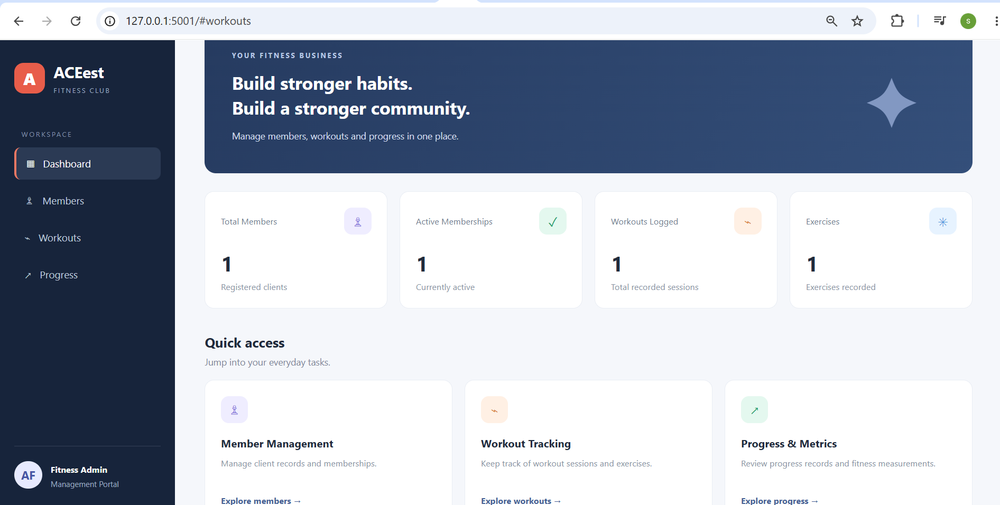

# ACEest Fitness & Gym — Automated CI/CD DevOps Pipeline

[](https://github.com/salandrishirisha/aceest-fitness-gym/actions/workflows/main.yml)
[](https://www.python.org/)
[](https://flask.palletsprojects.com/)
[](https://www.docker.com/)
[](https://github.com/salandrishirisha/aceest-fitness-gym/actions)

## 1. Project Overview

**ACEest Fitness & Gym** is a Flask-based fitness and gym management application developed to demonstrate automated software delivery using DevOps practices.

The project follows an incremental development approach:

- **Version 1 — Core Application:** Flask-based fitness management backend with REST API endpoints and SQLite persistence.
- **Version 2 — Dashboard UI:** A lightweight web dashboard that reads summary statistics from the existing Version 1 SQLite database and presents gym information through a browser-based interface.
- **Automated CI/CD:** GitHub Actions and Jenkins validate source code, run automated tests, build Docker images, and verify containerized application behavior.

The objective is to demonstrate how an application can evolve from a core backend into a user-facing interface while maintaining automated quality checks throughout development.

## 2. Project Objectives

- Maintain source code using Git and GitHub.
- Implement automated linting and Python compilation checks.
- Validate application behavior through Pytest.
- Package the application in a Docker container.
- Run tests inside the built container.
- Automate validation through GitHub Actions.
- Use Jenkins as an additional build and quality-validation pipeline.
- Demonstrate incremental application development through Version 1 and Version 2.

## 3. Architecture

```text
                    Developer / VS Code
                            |
                       Git Commit
                            |
                         GitHub
                            |
                 Push / Pull Request
                            |
                 GitHub Actions CI
                            |
          +-----------------+------------------+
          |                 |                  |
     Python Compile      Flake8             Pytest
          |                 |                  |
          +-----------------+------------------+
                            |
                     Docker Image Build
                            |
                  Containerized Unit Tests
                            |
                  Container Health Check


             Jenkins Secondary Validation
                            |
                     Git Checkout
                            |
                   Version 2 Workspace
                            |
                  Docker Image Build
                            |
                    Flake8 and Pytest
                            |
                    Build Result


     Version 1 Core Application
        Flask REST API + SQLite
                  |
                  | Existing SQLite database
                  |
     Version 2 Dashboard UI
        Flask + HTML/Jinja + CSS
                  |
             Browser on Port 5001
```

**Architecture note:** Version 2 is an incremental dashboard application that reads summary statistics from the existing Version 1 SQLite database. The Version 1 API and Version 2 dashboard run separately, using ports 5000 and 5001 respectively when run locally. The dashboard is not a replacement for the Version 1 API.

## 4. Application Versions

### Version 1 — Core Fitness Management Backend

Version 1 provides the core fitness management functionality through Flask REST API endpoints and SQLite persistence.

Key capabilities include:

- Client and membership management.
- Workout and exercise logging.
- Progress and fitness metric recording.
- Authentication endpoint.
- Membership status and workout program functionality, where supported by the application.
- Health endpoint for application status checks.

Representative API endpoints include:

| Endpoint | Purpose |
|---|---|
| `/api/auth/login` | Authentication |
| `/api/clients` | Client management |
| `/api/workouts` | Workout management |
| `/api/exercises` | Exercise logging |
| `/api/progress` | Progress tracking |
| `/api/metrics` | Fitness metric recording |
| `/health` | Application health check |

The exact request methods and payloads depend on the implemented endpoint.

**Default local URL:** `http://127.0.0.1:5000`

### Version 2 — Dashboard UI

Version 2 introduces a browser-based dashboard as an incremental enhancement to the core application.

The dashboard presents summary information such as:

- **Total Members:** Number of clients registered in the database.
- **Active Memberships:** Number of clients whose membership status is `Active`.
- **Total Workouts:** Number of recorded workouts.
- **Total Exercises:** Number of recorded exercises.

The dashboard uses Flask and Jinja templates to render HTML, with CSS styling for the user interface.

Version 2 also exposes a health endpoint:

```http
GET /health
```

Expected response:

```json
{
  "status": "UP",
  "version": "2.0.0"
}
```

**Default local URL:** `http://127.0.0.1:5001`

**Dashboard URL:** `http://127.0.0.1:5001/`

### Incremental Development Strategy

| Area | Version 1 | Version 2 |
|---|---|---|
| Primary purpose | Core fitness management | Dashboard and summary visualization |
| Interface | REST API | Browser-based UI |
| Technology | Flask, SQLite | Flask, Jinja templates, CSS, SQLite |
| Default port | 5000 | 5001 |
| Data | Core application database | Reads summary statistics from the existing database |
| Validation | Automated tests and linting | Dashboard tests, health check, linting, Docker validation |

The Version 2 dashboard is intended to reuse existing application data rather than introduce a separate fitness database.

## 5. Repository Structure

```text
aceest-fitness-gym/
├── .github/
│   └── workflows/
│       └── main.yml
├── app.py
├── requirements.txt
├── tests/
│   └── ...
├── version-2/
│   ├── app.py
│   ├── requirements.txt
│   ├── .flake8
│   ├── Dockerfile
│   ├── .dockerignore
│   ├── Jenkinsfile
│   ├── tests/
│   │   └── test_app.py
│   ├── templates/
│   │   └── index.html
│   └── static/
│       └── css/
│           └── style.css
└── README.md
```

The Version 1 source and tests remain at the repository root. Version 2 has its own application, dependencies, tests, Docker configuration, templates, and static resources.

## 6. Technology Stack

| Technology | Usage |
|---|---|
| Python 3.11 | Application and automation runtime |
| Flask 3.0.3 | Web framework |
| SQLite | Persistent application data |
| HTML and Jinja | Dashboard presentation |
| CSS | Dashboard styling |
| Pytest 8.2.2 | Automated testing |
| pytest-cov 5.0.0 | Test coverage reporting |
| Flake8 7.1.0 | Code-quality checks |
| Gunicorn 22.0.0 | Production-style WSGI server |
| Docker | Container image creation and execution |
| Git and GitHub | Source control and collaboration |
| GitHub Actions | Automated CI workflow |
| Jenkins | Secondary build and validation pipeline |
| Rocky Linux | Server environment for Docker and Jenkins |

## 7. Prerequisites

For local development:

- Python 3.11 recommended.
- Git.
- pip.
- Docker Desktop on Windows or Docker Engine on Linux.

For the Rocky Linux environment:

- Rocky Linux VM with repository access.
- Docker Engine installed and running.
- Git installed.
- VS Code Remote SSH or an SSH terminal.

For Jenkins:

- Jenkins installed and running.
- Git configured for repository checkout.
- Docker installed on the Jenkins agent.
- Jenkins user granted appropriate permission to execute Docker commands.

## 8. Clone the Repository

```bash
git clone https://github.com/salandrishirisha/aceest-fitness-gym.git
cd aceest-fitness-gym
```

## 9. Run Version 1 Locally

Create a virtual environment from the repository root.

### Windows

```powershell
python -m venv .venv
.venv\Scripts\activate
python -m pip install -r requirements.txt
python app.py
```

### Linux / Rocky Linux

```bash
python3 -m venv .venv
source .venv/bin/activate
python -m pip install -r requirements.txt
python app.py
```

Open:

`http://127.0.0.1:5000`

Test the health endpoint if supported by the Version 1 application:

```bash
curl http://127.0.0.1:5000/health
```

## 10. Run Version 2 Locally

Open a terminal in the `version-2` directory.

```bash
cd version-2
```

Install the Version 2 dependencies:

```bash
python -m pip install -r requirements.txt
```

Run the dashboard application:

```bash
python app.py
```

Open the dashboard:

`http://127.0.0.1:5001/`

Check the health endpoint:

```bash
curl http://127.0.0.1:5001/health
```

Expected response:

```json
{
  "status": "UP",
  "version": "2.0.0"
}
```

## 11. Automated Testing and Linting

The project uses Pytest to verify application behavior and Flake8 to check code quality.

### Version 1

From the repository root, install dependencies and run:

```bash
python -m pip install -r requirements.txt
python -m pytest -v
```

Run linting:

```bash
python -m flake8 .
```

### Version 2

From the `version-2` directory:

```bash
python -m pip install -r requirements.txt
```

Compile the application and tests:

```bash
python -m compileall -q app.py tests
```

Run Flake8:

```bash
python -m flake8 app.py tests
```

Run the tests with coverage:

```bash
python -m pytest -v --cov=app --cov-report=term-missing tests
```

The pipeline should proceed only when the required checks succeed. Test counts and coverage percentages should be taken from actual test output rather than assumed.

## 12. Docker Containerization — Version 2

Version 2 uses the `version-2/Dockerfile` to build a container image based on `python:3.11-slim`.

The container exposes port 5001 and runs the Flask application through Gunicorn.

### Build the image

Run these commands from the `version-2` directory:

```bash
docker build -t aceest-fitness-v2:local .
```

### Run the unit tests inside the image

```bash
docker run --rm aceest-fitness-v2:local python -m pytest -v tests
```

### Start the dashboard container

```bash
docker run -d \
  --name aceest-v2 \
  -p 5001:5001 \
  aceest-fitness-v2:local
```

### Verify the container

```bash
docker ps
curl http://127.0.0.1:5001/health
```

Open the dashboard at:

`http://127.0.0.1:5001/`

### Stop the container

```bash
docker stop aceest-v2
docker rm aceest-v2
```

The dashboard uses the database path configured by Version 2. If the SQLite database must persist across container restarts or be shared with Version 1, configure an appropriate Docker volume or bind mount and ensure both applications use the same database file.

## 13. GitHub Actions CI Pipeline

Workflow file:

`.github/workflows/main.yml`

Repository:

https://github.com/salandrishirisha/aceest-fitness-gym

GitHub Actions is configured to trigger on pushes and pull requests targeting the `main` branch.

### Version 2 CI stages

1. **Checkout Source Code** — Retrieves the repository.
2. **Set up Python 3.11** — Prepares the CI runtime and pip cache.
3. **Install Dependencies** — Installs the pinned Version 2 packages.
4. **Compile Python** — Checks application and test-file compilation.
5. **Lint** — Runs Flake8.
6. **Host Unit Tests** — Runs Pytest and produces coverage output.
7. **Docker Image Assembly** — Builds the Version 2 Docker image.
8. **Containerized Unit Tests** — Executes the tests inside the built image.
9. **Container Health Check** — Starts the container and verifies `/health`.

The workflow provides automated feedback on code quality, test results, Docker build integrity, and application startup.

### View the workflow

[Open ACEest Fitness GitHub Actions](https://github.com/salandrishirisha/aceest-fitness-gym/actions)

A successful workflow is indicated by a green check mark. A failed run can be investigated by opening the failed job and reviewing its logs.

## 14. Jenkins BUILD Pipeline

Jenkins provides an additional automated validation pipeline using the same GitHub repository.

### Configuration

- **Job type:** Freestyle project with an Execute shell build step, or a Pipeline job if using the repository's `Jenkinsfile`.
- **Source repository:** `https://github.com/salandrishirisha/aceest-fitness-gym.git`
- **Branch:** `main`
- **Application directory:** `version-2`

### Version 2 validation stages

1. Git checkout.
2. Docker availability check.
3. Docker image build.
4. Flake8 execution inside Docker.
5. Pytest execution inside Docker.
6. Jenkins build result reporting.

The Jenkins build script uses the Docker image to run quality checks, avoiding the need for pip on the Jenkins host.

Jenkins must have access to the Docker daemon. On Rocky Linux, the Jenkins service account may require Docker group membership or another approved Docker access configuration. Docker access is highly privileged and should be restricted to trusted accounts.

### Expected result

```text
===== ACEest Fitness Version 2 Jenkins Build =====
===== Build Docker Image =====
===== Run Flake8 Inside Docker =====
===== Run Unit Tests Inside Docker =====
===== Jenkins Build Successful =====
Finished: SUCCESS
```

These lines are the expected successful output, not a claim that every build has already passed.

## 15. Version Control Strategy

Git is used to track incremental development, fixes, and DevOps automation.

Suggested Conventional Commit prefixes:

| Prefix | Purpose |
|---|---|
| `feat:` | Introduces application functionality |
| `fix:` | Corrects a defect |
| `refactor:` | Improves internal code structure |
| `build:` | Updates build configuration or dependencies |
| `test:` | Adds or modifies automated tests |
| `ci:` | Updates CI/CD automation |
| `docs:` | Updates README or other documentation |

Example commands:

```bash
git status
git add README.md
git commit -m "docs: document Version 2 UI and CI pipeline"
git push origin main
```

## 16. Troubleshooting

### Docker permission denied

If Docker returns a permission error, check the Docker daemon and the Jenkins service account's access to the Docker socket.

```bash
sudo systemctl status docker
sudo -u jenkins -g docker docker ps
```


## 17. Security and Operational Considerations

- Keep credentials, tokens, and secrets out of source control.
- Use environment variables or an appropriate secrets manager for sensitive configuration.
- Restrict access to the Docker daemon and Jenkins administration.
- Avoid exposing development and management endpoints publicly without appropriate access controls.
- Use persistent storage for SQLite data when container restarts must preserve records.
- Treat successful CI tests as quality evidence, not a substitute for production security and operational reviews.


## 18. Conclusion

ACEest Fitness & Gym demonstrates an incremental application lifecycle, from a Flask-based fitness management backend to a browser-based dashboard, supported by automated DevOps practices.

The project combines GitHub source control, Pytest, Flake8, Docker containerization, GitHub Actions, and Jenkins to establish repeatable validation steps before changes are considered ready.

The Version 2 dashboard extends the application interface while retaining the existing SQLite data model, illustrating how a small application can evolve through incremental development and automated quality checks.

## 19. Academic Reference

- **Course:** CSIZG514 / SEZG514 — Introduction to DevOps
- **Institution:** BITS Pilani
- **Name:** SALANDRI SHIRISHA
- **Application:** ACEest Fitness & Gym
- **Project focus:** Automated CI/CD pipelines, Docker containerization, GitHub Actions, Jenkins, automated testing, and incremental UI development


